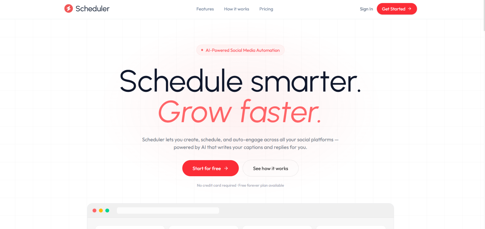
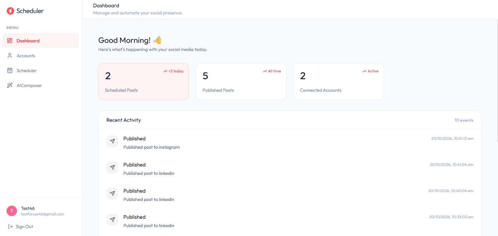
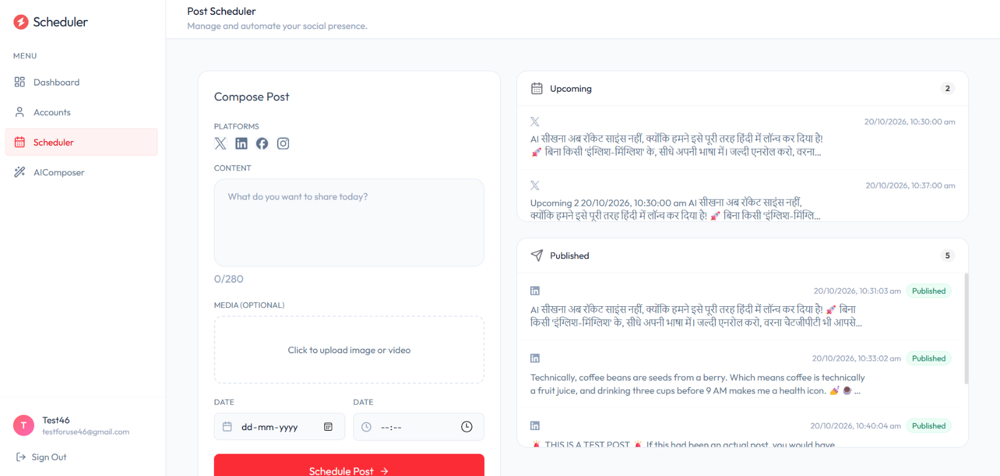
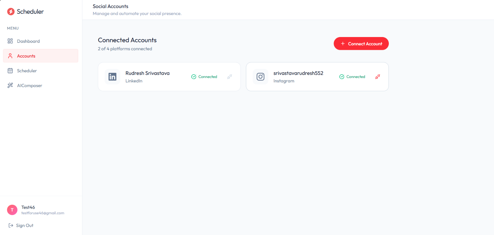
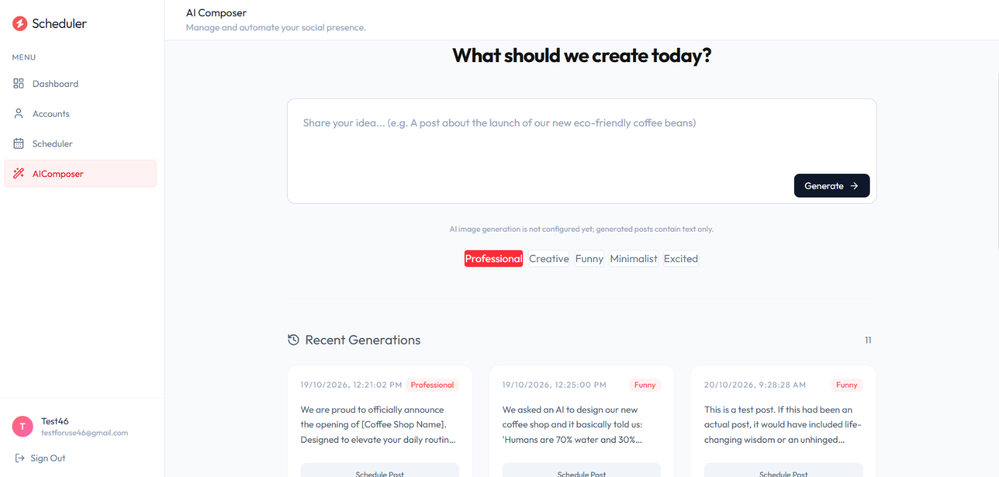

# AI-Powered Social Media Automation

A full-stack social media scheduling app with AI-assisted post writing, account connections, and a dashboard for scheduled and published posts.

<p align="center">
  
</p>

<p align="center">
  <strong>Plan, create, and publish social content from one place.</strong>
</p>

## App preview

<table>
  <tr>
    <td align="center" width="50%">
      <strong>Dashboard</strong><br>
      
    </td>
    <td align="center" width="50%">
      <strong>Post Scheduler</strong><br>
      
    </td>
  </tr>
  <tr>
    <td align="center" width="50%">
      <strong>Connected Accounts</strong><br>
      
    </td>
    <td align="center" width="50%">
      <strong>AI Composer</strong><br>
      
    </td>
  </tr>
</table>

## Features

- Sign up and log in with JWT-based authentication.
- Connect supported social accounts through Zernio OAuth.
- Draft and schedule posts for connected platforms.
- Generate post copy with Gemini (`gemini-3.1-flash-lite`).
- Upload post media and schedule publishing.
- View scheduled posts, published posts, and recent activity.
- Run scheduled publishing through a server-side cron job.

## Tech stack

- **Frontend:** React, TypeScript, Vite, Tailwind CSS
- **Backend:** Node.js, Express, TypeScript
- **Database:** MongoDB with Mongoose
- **Integrations:** Google Gemini API and Zernio

## Repository structure

```text
.
├── client/   # React/Vite frontend
└── server/   # Express API, MongoDB models, and publishing scheduler
```

## Requirements

- Node.js and npm
- A MongoDB database (MongoDB Atlas is suitable)
- A Gemini API key for AI post generation
- A Zernio API key for social account connections and publishing

## Run locally

1. Clone the repository and install each app's dependencies:

   ```bash
   cd server
   npm install
   cd ../client
   npm install
   ```

2. Create `server/.env`:

   ```env
   PORT=3000
   MONGODB_URI=mongodb+srv://<username>:<password>@<cluster>/<database>
   JWT_SECRET=<use-a-long-random-secret>
   GEMINI_API_KEY=<your-gemini-api-key>
   ZERNIO_API_KEY=<your-zernio-api-key>
   ```

3. Start the backend in one terminal:

   ```bash
   cd server
   npm run server
   ```

   The API listens on `http://localhost:3000`.

4. Create `client/.env`:

   ```env
   VITE_API_BASE_URL=http://localhost:3000
   ```

5. Start the frontend in another terminal:

   ```bash
   cd client
   npm run dev
   ```

   Open the local URL printed by Vite (typically `http://localhost:5173`).

## Available commands

Run commands from the relevant folder.

### Client (`client/`)

| Command | Description |
| --- | --- |
| `npm run dev` | Start the Vite development server |
| `npm run build` | Type-check and create the production build in `dist/` |
| `npm run preview` | Preview the production build locally |
| `npm run lint` | Run ESLint |

### Server (`server/`)

| Command | Description |
| --- | --- |
| `npm run server` | Start the development server with Nodemon and TSX |
| `npm start` | Start the server with TSX |
| `npm run build` | Compile TypeScript into `dist/` |

## Deploy

### Backend on Render

Create a **Web Service** connected to this repository:

- **Root Directory:** `server`
- **Build Command:** `npm install && npm run build`
- **Start Command:** `node dist/server.js`

Set these environment variables in Render:

- `MONGODB_URI`
- `JWT_SECRET`
- `GEMINI_API_KEY`
- `ZERNIO_API_KEY`

Render provides `PORT` for the web service. The app uses it automatically.

The server runs a cron scheduler for publishing scheduled posts. Use an always-on service plan; a service that sleeps may not execute scheduled publishing reliably.

### Frontend on Vercel

Import the repository as a Vercel project:

- **Root Directory:** `client`
- **Framework Preset:** Vite
- **Build Command:** `npm run build`
- **Output Directory:** `dist`

Set the Vercel environment variable:

```env
VITE_API_BASE_URL=https://<your-render-service>.onrender.com
```

Redeploy after setting environment variables. If directly refreshing client-side routes returns a 404, configure a Vercel rewrite to serve `index.html` for application routes.

### OAuth, CORS, and database access

- The OAuth return URL is currently constructed from the browser request's `Origin` and returns to `/accounts`. Configure Zernio and the connected social providers to accept your deployed Vercel domain and the corresponding OAuth flow.
- The API currently enables CORS for all origins. Before production use, restrict it to the deployed frontend origin.
- Configure MongoDB Atlas Network Access to allow connections from the deployed Render service. Prefer allowing the service's outbound IP addresses where available instead of allowing access from everywhere.

## Security notes

- Never commit `.env` files, API keys, database credentials, or JWT secrets.
- Use a long, unique `JWT_SECRET` in production. Do not rely on the development fallback secret.
- `VITE_` environment variables are included in the browser bundle. Only put public configuration, such as the API base URL, in Vercel.

## License

No license has been specified for this repository yet.
